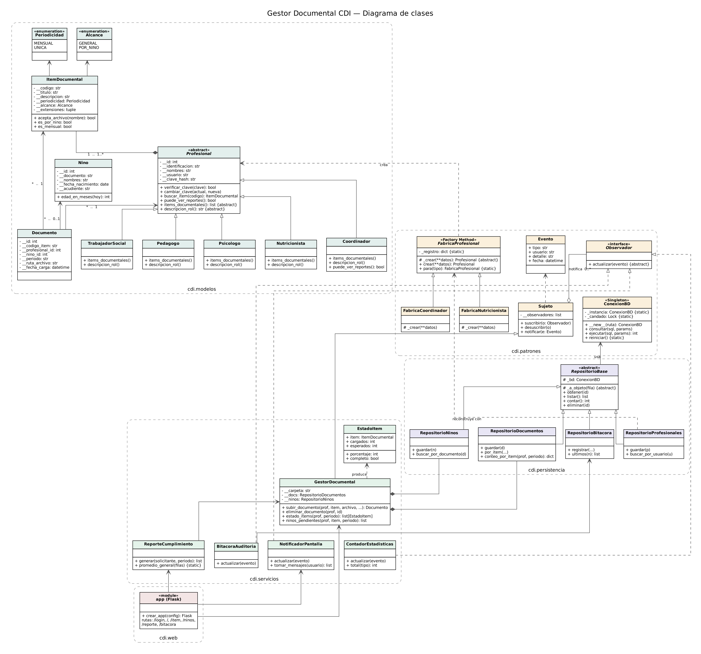

# Gestor Documental CDI

Aplicación web en Python para organizar los documentos que cada profesional de un
**Centro de Desarrollo Infantil (CDI)** debe cargar mes a mes. Cada profesional
entra con su usuario y ve sus propios **ítems** (títulos), por ejemplo la
nutricionista ve: *Entrega de Bienestarina*, *Actas de educación a padres de familia*,
*Carné de vacunación*, *Datos antropométricos* y *Novedades especiales del mes*.
La coordinación ve el porcentaje de cumplimiento de todo el equipo.

> Proyecto final del curso de Programación Orientada a Objetos.



## Funcionalidades

- Inicio de sesión por profesional (claves cifradas).
- Panel con los ítems del profesional y su avance en el periodo (mes) elegido.
- Ítems **generales** (un documento por mes) e ítems **por niño** (un documento por cada niño registrado).
- Ítems **mensuales** y de **única vez** (por ejemplo, el carné de vacunación).
- Validación de formato de archivo por ítem (PDF, imagen, Excel, Word) y tamaño máximo de 10 MB.
- Lista de niños pendientes en cada ítem por niño.
- Registro de niños y niñas del CDI.
- Reporte de cumplimiento y bitácora de auditoría (solo coordinación).

## Profesionales e ítems

| Profesional | Ítems |
|---|---|
| Nutricionista Dietista | Entrega de Bienestarina · Actas de educación a padres · Carné de vacunación (por niño) · Datos antropométricos (por niño) · Novedades del mes |
| Psicólogo(a) | Valoración psicosocial inicial (por niño) · Actas de talleres con familias · Remisiones · Novedades del mes |
| Docente / Pedagogo(a) | Planeación pedagógica · Seguimiento al desarrollo (por niño) · Registro de asistencia · Novedades del mes |
| Trabajador(a) Social | Ficha de caracterización familiar (por niño) · Visitas domiciliarias · Novedades del mes |
| Coordinador(a) | Informe mensual de gestión · Actas de comité técnico |

## Conceptos de POO aplicados

| Concepto | Dónde |
|---|---|
| Encapsulamiento | Atributos privados (`__nombre`) con `@property` de solo lectura en todas las clases del modelo |
| Herencia | `Profesional` → 5 subclases; `RepositorioBase` → 4 repositorios; `Sujeto` → `GestorDocumental` |
| Polimorfismo | `items_documentales()`, `descripcion_rol()` y `puede_ver_reportes()` cambian según el profesional |
| Abstracción | Clases abstractas `Profesional`, `RepositorioBase`, `FabricaProfesional`, `Observador` |
| **Singleton** | `cdi/patrones/singleton.py` — una sola conexión a la base de datos |
| **Factory Method** | `cdi/patrones/fabrica.py` — crea el profesional correcto según su tipo |
| **Observer** | `cdi/patrones/observador.py` + `cdi/servicios/observadores.py` — bitácora y avisos al subir/eliminar |

## Estructura

```
cdi-documentos/
├── run.py                  # punto de entrada
├── cdi/
│   ├── modelos/            # Profesional y subclases, ItemDocumental, Nino, Documento
│   ├── patrones/           # Singleton, Factory Method, Observer
│   ├── persistencia/       # esquema SQLite y repositorios
│   ├── servicios/          # GestorDocumental, observadores, reportes
│   └── web/                # Flask: rutas, plantillas y estilos
├── tests/                  # 43 pruebas unitarias (unittest)
├── scripts/                # medición de eficiencia y generación del UML
└── docs/uml/               # diagramas (PNG, SVG, DOT y PlantUML)
```

## Cómo ejecutarlo en Visual Studio Code

1. Instalar **Python 3.10 o superior** y la extensión **Python** de Microsoft en VS Code.
2. Abrir la carpeta del proyecto: *Archivo → Abrir carpeta…*
3. Abrir la terminal (*Ver → Terminal*) y crear un entorno virtual:
   ```bash
   python -m venv .venv
   # Windows
   .venv\Scripts\activate
   # macOS / Linux
   source .venv/bin/activate
   ```
4. Instalar dependencias:
   ```bash
   pip install -r requirements.txt
   ```
5. Ejecutar: presionar **F5** y elegir *“Ejecutar Gestor Documental CDI”*, o en la terminal:
   ```bash
   python run.py
   ```
6. Abrir **http://127.0.0.1:5000** en el navegador.

### Usuarios de prueba (clave `cdi2026`)

| Usuario | Rol |
|---|---|
| `nutricion` | Nutricionista |
| `psicologia` | Psicóloga |
| `pedagogia` | Docente |
| `trabajosocial` | Trabajadora social |
| `coordinacion` | Coordinadora (ve reportes y bitácora) |

La base de datos y los archivos subidos se guardan en la carpeta `instance/`
(no se sube a Git). Para empezar de cero basta con borrar esa carpeta.

## Pruebas

```bash
python -m unittest discover -s tests -t . -v
```

También se pueden correr desde el panel **Pruebas** (ícono del matraz) de VS Code.

## Análisis de eficiencia

```bash
python scripts/medir_eficiencia.py
```

Los resultados están en `docs/resultados_eficiencia.txt`.

## Regenerar los diagramas UML

Requiere [Graphviz](https://graphviz.org/download/) instalado:

```bash
python scripts/generar_uml.py
```

## Flujo de trabajo con Git

Se trabajó con ramas, como en un equipo profesional:

- `main`: versiones estables (etiqueta `v1.0.0`).
- `develop`: integración.
- `feature/*` y `docs/*`: una rama por funcionalidad, integradas a `develop` con *merge* sin avance rápido (`--no-ff`) para que quede registro de cada etapa.

Mensajes de commit con el formato *Conventional Commits* (`feat`, `test`, `docs`, `perf`, `style`, `chore`).
